# 医学科研绘图素材库

医学与生命科学素材、通用 PPT 图标、离线人体图谱与术式示意，以及供 AI 使用的素材检索和绘图流程。公开素材包包含 **23,192 条记录**：医学 19,286 条、通用 PPT 3,906 条。

<!-- ASSET_PREVIEW_START -->
## 素材预览

以下为公开素材库中实际收录的部分原件。点击图片可放大查看；完整素材与检索程序见下方下载入口。

| 细胞与细胞器 | 器官与组织 | 分子与测序 | 实验设备 |
|:---:|:---:|:---:|:---:|
| <a href="docs/preview/assets/macrophage.svg">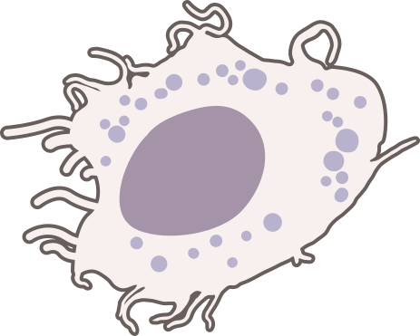</a> 巨噬细胞 | <a href="docs/preview/assets/liver.svg">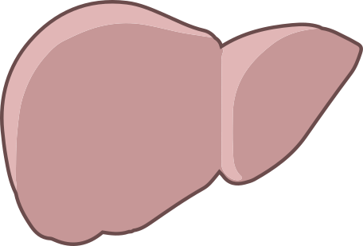</a> 人肝脏 |  DNA核酸 |  共聚焦显微镜 |
| <a href="docs/preview/assets/t-cell.svg">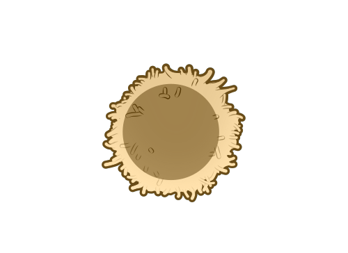</a> T细胞 | <a href="docs/preview/assets/pancreas.svg">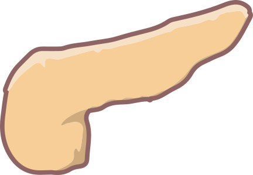</a> 人胰腺 |  RNA核酸 | <a href="docs/preview/assets/pipette.svg">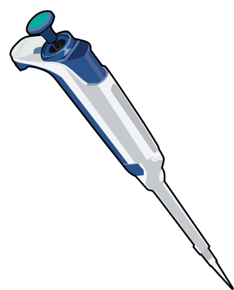</a> 移液器 |
| <a href="docs/preview/assets/mitochondrion.svg">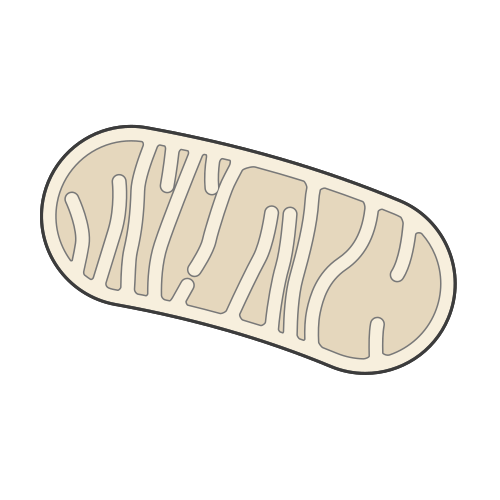</a> 线粒体 | <a href="docs/preview/assets/kidney.svg">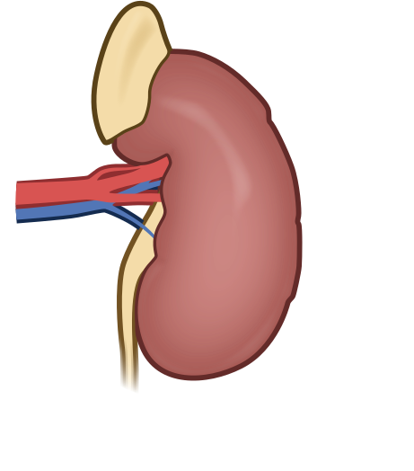</a> 人肾脏 |  抗体 | <a href="docs/preview/assets/qpcr-machine.svg">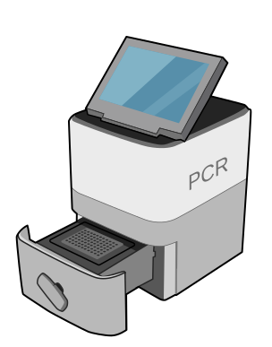</a> 实时定量PCR仪 |
| <a href="docs/preview/assets/lysosome.svg">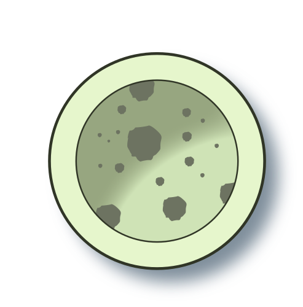</a> 溶酶体 | <a href="docs/preview/assets/heart.svg">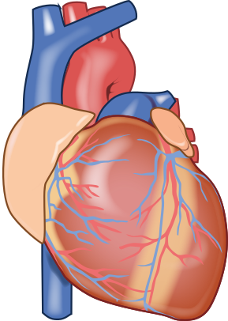</a> 人心脏 | <a href="docs/preview/assets/single-cell-rna-seq.svg">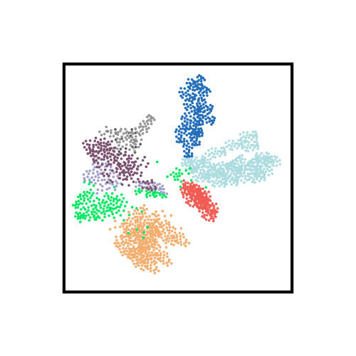</a> 单细胞RNA测序示意 | <a href="docs/preview/assets/flow-cytometer.png">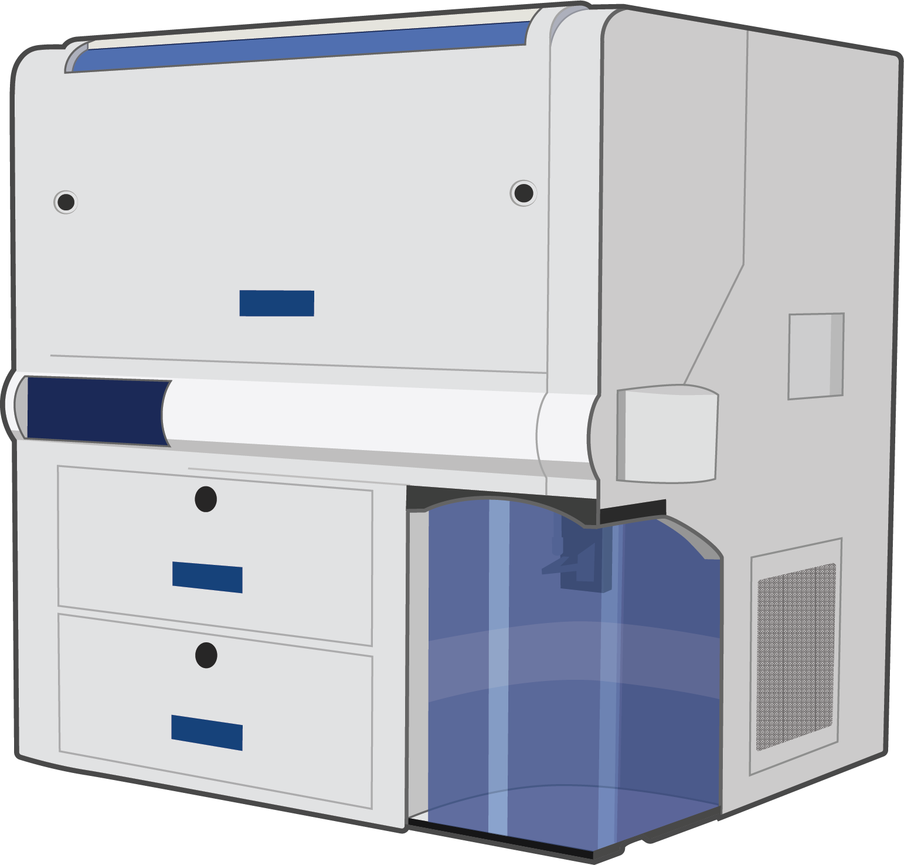</a> 流式细胞仪 |

这 16 件示例来自 **NIH BioArt**，作者 **Ryan Kissinger**，原素材为 **Public Domain**。逐项来源、许可和处理记录见 [预览素材署名](docs/preview/assets/CREDITS.md)。

## 数据库 HTML 实际页面

截图来自 `v2026.10.20-ccby` 公开发行包，保留页面中的素材、来源和操作区域。点击任意截图查看原尺寸。

| 科研 PPT 素材 | 通用 PPT 素材 |
|:---:|:---:|
| <a href="docs/preview/assets/browser-ppt.png">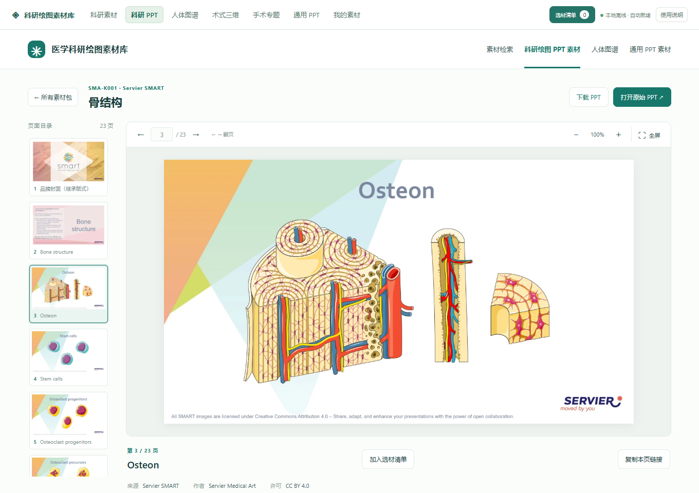</a> Servier SMART 骨结构素材：Osteon，第 3 / 23 页。保留原作者标识与许可文字。 | <a href="docs/preview/assets/browser-general.png">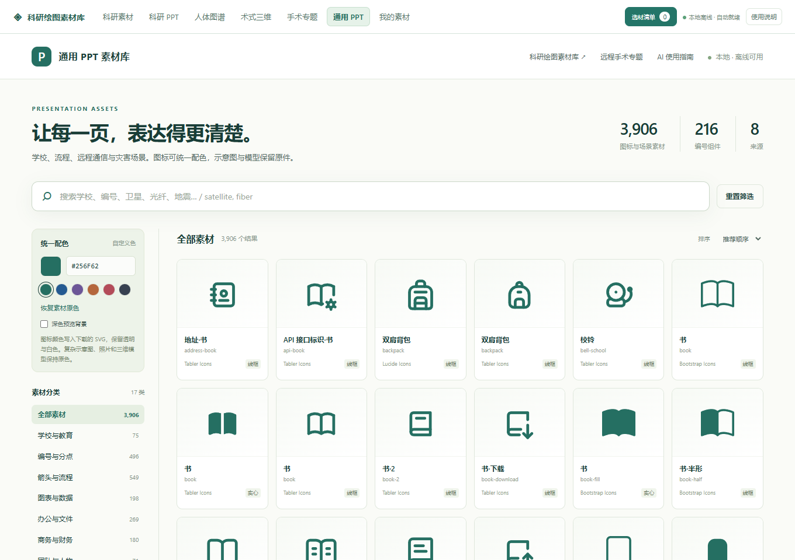</a> 图标网格、分类与统一配色；示例来源含 Tabler、Lucide、Bootstrap。 |

| 医学素材检索 | 机器人与手术专题 |
|:---:|:---:|
| <a href="docs/preview/assets/browser-medical.png">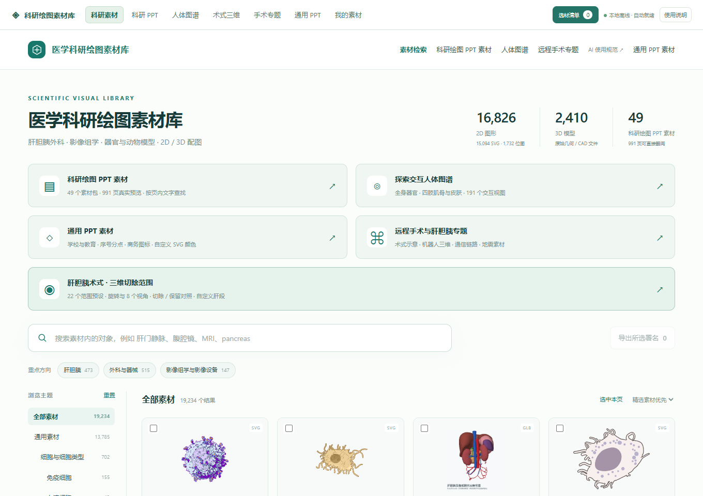</a> 细胞、器官和三维素材统一检索；图中首排为 B 细胞、树突状细胞、腹部器官场景和巨噬细胞。 | <a href="docs/preview/assets/browser-remote.png">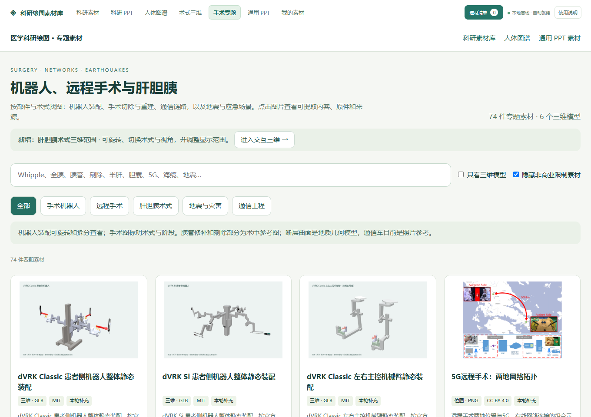</a> dVRK 静态装配与远程手术专题；网络图来自机器人仿体上的远程演示研究。 |

| 肝胆胰三维范围 | 人体解剖图谱 |
|:---:|:---:|
| <a href="docs/preview/assets/browser-surgery.png">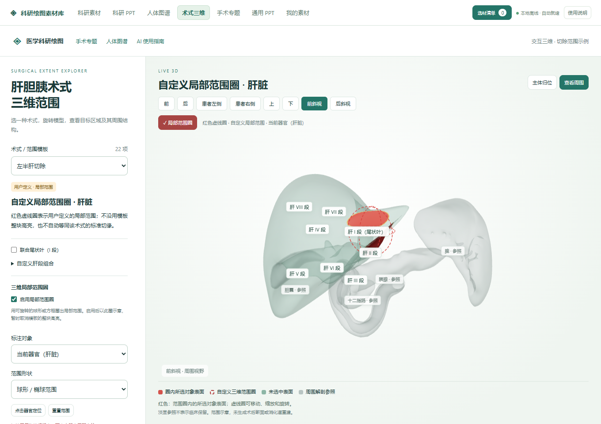</a> HRA 同源腹部结构与自定义局部范围圈，仅用于参考示意，不用于患者切缘或手术规划。 | <a href="docs/preview/assets/browser-atlas.png">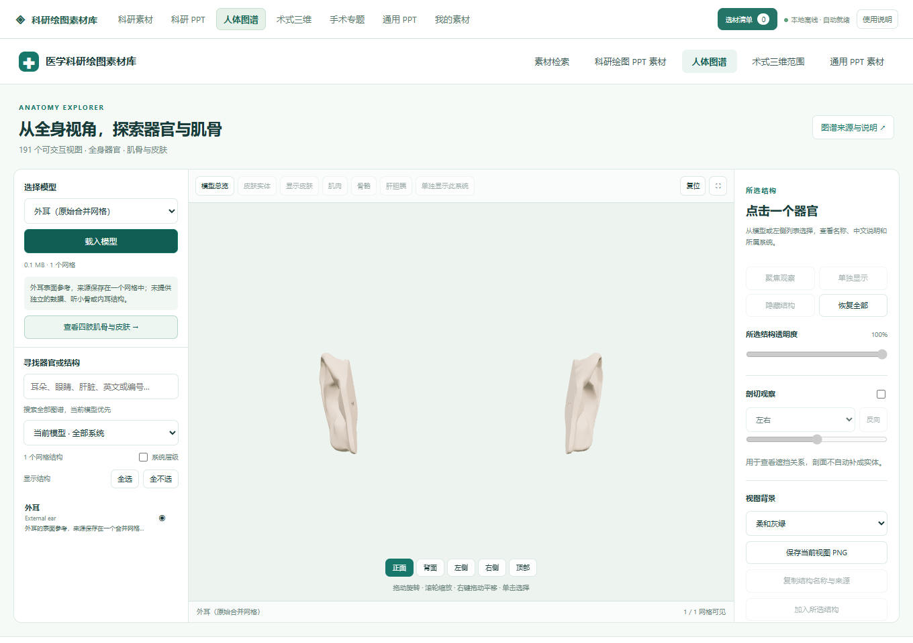</a> BodyParts3D 外耳原始合并网格示例，可旋转观察；不代表完整内部耳结构。 |

页面内第三方素材分别保留原许可，截图不改变其授权条件。[查看作者、来源与完整许可声明](docs/preview/assets/CREDITS.md)。

<!-- ASSET_PREVIEW_END -->

**当前版本：[`v2026.10.20-ccby`](https://github.com/jerryyao46-ux/medical-research-illustration-library/releases/tag/v2026.10.20-ccby)。完整源码与素材包从该 Release 下载；当前仓库分支作为项目入口，完整源码以 ZIP 分发。**

## 下载与使用

阅读、修改程序与工作流：下载[完整源码 ZIP](https://github.com/jerryyao46-ux/medical-research-illustration-library/releases/download/v2026.10.20-ccby/medical-research-illustration-library-source.zip)。解压后阅读 `README.md`；包内包含完整源码、文档、工具、测试及许可记录，不附内置素材数据。

请下载上述手工上传的完整源码 ZIP；GitHub 自动生成的 `Source code (zip/tar.gz)` 不包含完整程序及素材。

浏览完整素材库：下载以下**全部六卷**，依次解压到同一个父目录，合并共同的 `medical-illustration-library/` 文件夹，再双击其中的 `打开素材库.html`。

[第 1 卷](https://github.com/jerryyao46-ux/medical-research-illustration-library/releases/download/v2026.10.20-ccby/medical-illustration-library-data-01-of-06.zip) · [第 2 卷](https://github.com/jerryyao46-ux/medical-research-illustration-library/releases/download/v2026.10.20-ccby/medical-illustration-library-data-02-of-06.zip) · [第 3 卷](https://github.com/jerryyao46-ux/medical-research-illustration-library/releases/download/v2026.10.20-ccby/medical-illustration-library-data-03-of-06.zip) · [第 4 卷](https://github.com/jerryyao46-ux/medical-research-illustration-library/releases/download/v2026.10.20-ccby/medical-illustration-library-data-04-of-06.zip) · [第 5 卷](https://github.com/jerryyao46-ux/medical-research-illustration-library/releases/download/v2026.10.20-ccby/medical-illustration-library-data-05-of-06.zip) · [第 6 卷](https://github.com/jerryyao46-ux/medical-research-illustration-library/releases/download/v2026.10.20-ccby/medical-illustration-library-data-06-of-06.zip)

完整浏览包已经包含程序与数据，无需另行覆盖源码包。离线浏览使用 Edge 或 Chrome，无需启动服务；AI 检索与维护工具的依赖见包内 `docs/INSTALL.md`。下载时一并保存 Release 的校验清单和 `VALIDATION_REPORT.md`。

## 让 AI 绘图

把解压后的项目目录放到 AI 能访问的位置，选择一个入口引用，并提供研究材料与输出要求：

- `机制图绘图.md`：AI 自主检索、选材、制作与检查。
- `机制图绘图_协作选材.md`：用户挑选主体素材后，AI 继续制作。

## 素材精查与原生 PPT 经验

- **查到真正可用的部件。** 检索命中后继续看原件、具体页和分组，核对对象身份、可提取结构、许可与编辑范围；标签相似不代表科学含义相同。
- **先建立清楚的生物场景。** 用主体尺度、结构归属和局部放大组织画面，保留不同研究、区室与证据边界，避免补出没有依据的机制箭头。
- **按真实结构制作原生对象。** 优先考虑已有可编辑组件；移植 PPT 分组或转换 SVG 时一并处理坐标、样式、媒体与依赖，整页位图不能称为原生重建。
- **分别核验内容、显示与实际编辑。** 从最终文件重新检查，并在副本中实际改文字、颜色、分组或节点；局部修改还要对照已认可区域，说明抽查范围与未验证部分。

完整说明见包内 **`docs/harness/ASSET_REVIEW_AND_NATIVE_PPT.md`**。实际绘图能力由当前 AI 工具决定；程序测试不能代替具体图稿的科学审查与编辑验收。

## 许可与仓库署名

本项目有权授权的**原创代码、原创技术文档与原创图形采用 [CC BY 4.0](https://creativecommons.org/licenses/by/4.0/)**。第三方素材和软件各自保留上游许可，本项目不能替它们重新授权。具体范围见包内 `LICENSE_SCOPE.md`、`THIRD_PARTY_ASSETS.md`、`THIRD_PARTY_SOFTWARE.md` 和逐项 `licenses/` 清单。

使用本项目原创内容时，请注明项目与作者、链接本仓库和许可，并说明修改。可按实际使用情况采用以下署名；引用第三方素材时，还须保留原作者与其许可信息：

> 来源：医学科研绘图素材库，Medical Illustration Asset Library contributors。仓库：https://github.com/jerryyao46-ux/medical-research-illustration-library 。原创内容许可：CC BY 4.0，https://creativecommons.org/licenses/by/4.0/ 。使用版本：v2026.10.20-ccby；修改说明：填写实际修改，未修改则注明未修改。

更完整的署名与引用信息见包内 `ATTRIBUTION.md` 和 `CITATION.cff`。

公开包排除受限或待复核素材、个人素材、病例、备份及缓存。术式三维为参考示意，不用于患者切缘或手术规划。
